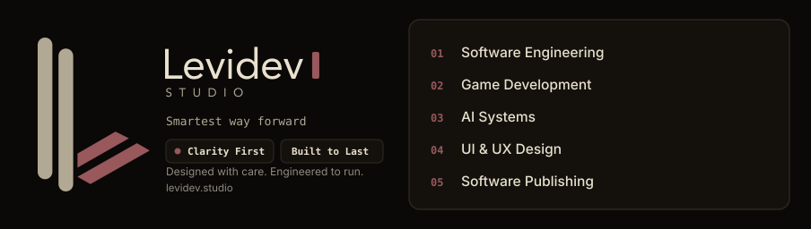
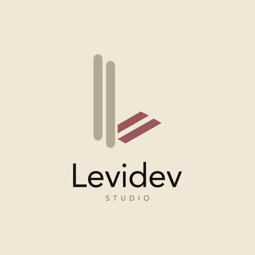

# Levidev Studio, Google Business Profile & Brand Kit

Paste-ready Google Business Profile copy (`PROFILE.md`), full SVG logo system across all three families (Icon Only, Icon + Word, and Full-Text Wordmark) in Light Mode, Dark Mode, and CSS-animated SVG, plus the complete [`assets/kit/`](assets/kit/) brand package. **Documented brand files live under [`assets/`](assets/README.md)** (`gbp/`, `kit/`, `marks/`, `posts/`, `letterhead/`, `schema-*.jsonld`). An optional internal `final/` tree may exist in some workflows; treat `assets/` as the public reference paths in this repo.

  

#  Levidev Studio

## 1. Three Logo Families (SVG + Animated SVG + PNG)

Every text glyph in the logo SVGs is converted to vector `<path>` outlines (`Avenir-Roman` for `Levidev` and wide, high-legibility `AvenirNext-DemiBold` for `STUDIO`) so the icon and typography stay in proportion at any distance without requiring font installation.

### A. Logo Icon Only (L-Shape Symbol)

| Variant | SVG | Animated SVG | PNG (for GBP / upload) |
| --- | --- | --- | --- |
| Light Mode (`#f0e7d6`) | [assets/icon-only-light.svg](assets/icon-only-light.svg) | [assets/icon-only-animated-light.svg](assets/icon-only-animated-light.svg) | [assets/gbp/icon-only.png](assets/gbp/icon-only.png) |
| Dark Mode (`#14110d`) | [assets/icon-only-dark.svg](assets/icon-only-dark.svg) | [assets/icon-only-animated-dark.svg](assets/icon-only-animated-dark.svg) | [assets/gbp/icon-only-dark.png](assets/gbp/icon-only-dark.png) |

### B. Full Icon + Word (Square & Horizontal Combination Lockups)

In `full-icon-animated-light.svg` and `full-icon-animated-dark.svg`, the L-shape icon stays intact while the `Levidev` and `STUDIO` wording transitions smoothly from invisible (`opacity: 0`) to visible (`opacity: 1`).

| Variant | SVG | Animated SVG | PNG (for GBP / upload) |
| --- | --- | --- | --- |
| Square Light (GBP circle crop) | [assets/full-icon-light.svg](assets/full-icon-light.svg) | [assets/full-icon-animated-light.svg](assets/full-icon-animated-light.svg) | [assets/gbp/logo-wordmark.png](assets/gbp/logo-wordmark.png) |
| Square Dark | [assets/full-icon-dark.svg](assets/full-icon-dark.svg) | [assets/full-icon-animated-dark.svg](assets/full-icon-animated-dark.svg) | [assets/gbp/logo-dark.png](assets/gbp/logo-dark.png) |
| Horizontal Light | [assets/wordmark-light.svg](assets/wordmark-light.svg) | [assets/wordmark-animated-light.svg](assets/wordmark-animated-light.svg) | [assets/gbp/wordmark.png](assets/gbp/wordmark.png) |
| Horizontal Dark | [assets/wordmark-dark.svg](assets/wordmark-dark.svg) | [assets/wordmark-animated-dark.svg](assets/wordmark-animated-dark.svg) | [assets/gbp/wordmark-dark.png](assets/gbp/wordmark-dark.png) |

### C. Logo Wordmark (Full-Text with Rose Bar)

| Variant | SVG | Animated SVG | PNG (for GBP / upload) |
| --- | --- | --- | --- |
| Square Light | [assets/marks/wordmark-text-light.svg](assets/marks/wordmark-text-light.svg) | [assets/marks/wordmark-text-animated-light.svg](assets/marks/wordmark-text-animated-light.svg) | [assets/gbp/logo-text-light.png](assets/gbp/logo-text-light.png) |
| Square Dark | [assets/marks/wordmark-text-dark.svg](assets/marks/wordmark-text-dark.svg) | [assets/marks/wordmark-text-animated-dark.svg](assets/marks/wordmark-text-animated-dark.svg) | [assets/gbp/logo-text-dark.png](assets/gbp/logo-text-dark.png) |
| Wide Light | [assets/marks/wordmark-wide-light.svg](assets/marks/wordmark-wide-light.svg) | [assets/marks/wordmark-wide-animated-light.svg](assets/marks/wordmark-wide-animated-light.svg) | [assets/gbp/wordmark-text-wide-light.png](assets/gbp/wordmark-text-wide-light.png) |
| Wide Dark | [assets/marks/wordmark-wide-dark.svg](assets/marks/wordmark-wide-dark.svg) | [assets/marks/wordmark-wide-animated-dark.svg](assets/marks/wordmark-wide-animated-dark.svg) | [assets/gbp/wordmark-text-wide-dark.png](assets/gbp/wordmark-text-wide-dark.png) |

## 2. Hero Banners & 3×3 Brand Kit Board

| Asset | Static SVG | Animated SVG | PNG |
| --- | --- | --- | --- |
| 3-Column Hero Banner (Dark) | [assets/banner-dark.svg](assets/banner-dark.svg) ([`gbp/banner.svg`](assets/gbp/banner.svg)) | [assets/banner-animated-dark.svg](assets/banner-animated-dark.svg) | [assets/gbp/banner.png](assets/gbp/banner.png) |
| 3-Column Hero Banner (Light) | [assets/banner-light.svg](assets/banner-light.svg) | [assets/banner-animated-light.svg](assets/banner-animated-light.svg) | [assets/gbp/banner-light.png](assets/gbp/banner-light.png) |
| 3×3 Brand Identity Board | [assets/kit/brandkit-board.svg](assets/kit/brandkit-board.svg) | [assets/kit/brandkit-board-animated.svg](assets/kit/brandkit-board-animated.svg) | [assets/kit/brandkit-board.png](assets/kit/brandkit-board.png) |

Full kit artifacts (iOS `AppIcon.appiconset`, Android adaptive `mipmap-*`, Web favicons & manifest, Open Graph / X / GitHub social cards, concept sheet, tiles board, and HTML presentation boards) are in `assets/kit/`.

## 3. Google Business Profile Cover and Posts

| Image | File |
| --- | --- |
| Cover, Indonesian | [assets/gbp/cover-id.png](assets/gbp/cover-id.png) |
| Cover, English | [assets/gbp/cover-en.png](assets/gbp/cover-en.png) |
| Services post, Indonesian | [assets/posts/services-id.png](assets/posts/services-id.png) |
| Services post, English | [assets/posts/services-en.png](assets/posts/services-en.png) |
| How a job ends, Indonesian | [assets/posts/start-id.png](assets/posts/start-id.png) |
| How a job ends, English | [assets/posts/start-en.png](assets/posts/start-en.png) |
